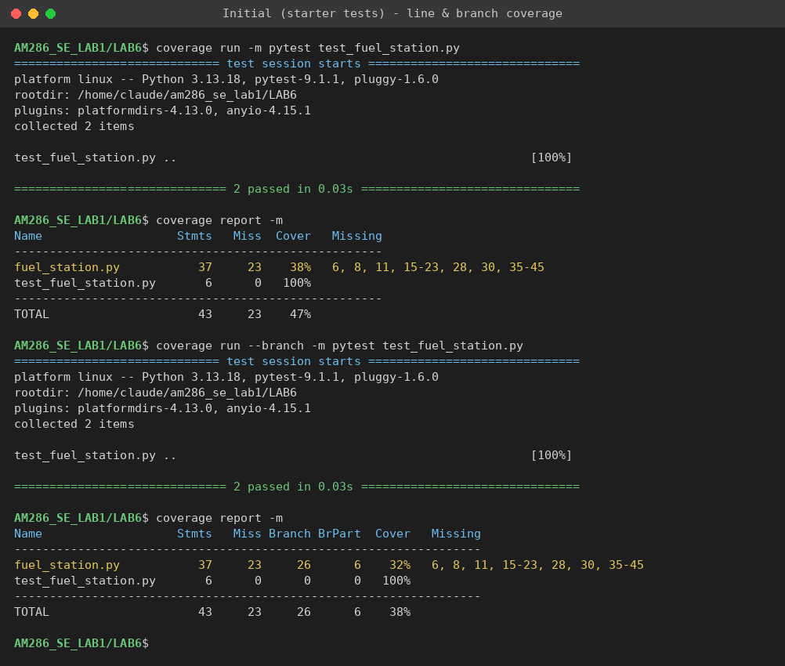
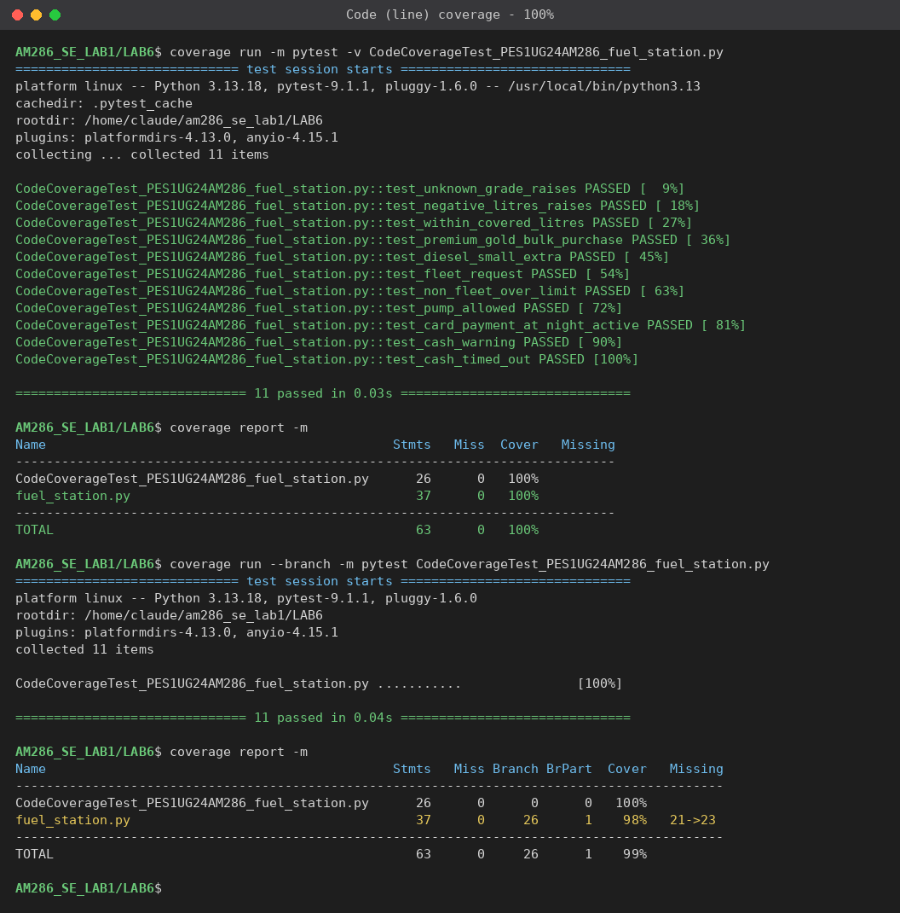
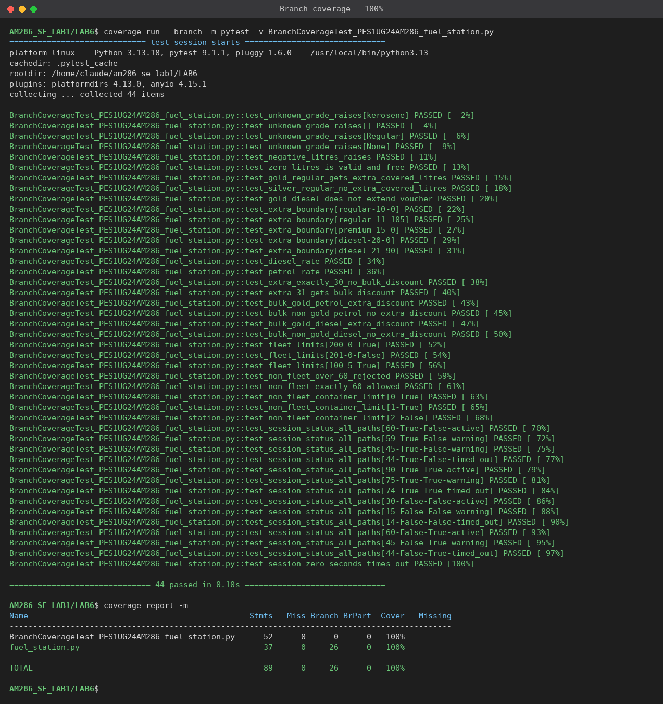

# Lab 6: Code and Branch Coverage Analysis — Fuel Station

**Name:** Sriranga Bharadwaj  **SRN:** PES1UG24AM286  **Section:** E
**Assigned repo:** [SETAPESU26/L6_L7_47_fuel_station](https://github.com/SETAPESU26/L6_L7_47_fuel_station)

## Files

| File | Description |
|------|-------------|
| `fuel_station.py` | Module under test (unchanged from the assigned repo) |
| `test_fuel_station.py` | Starter test file (unchanged) |
| `CodeCoverageTest_PES1UG24AM286_fuel_station.py` | Test cases written for **code (line) coverage** |
| `BranchCoverageTest_PES1UG24AM286_fuel_station.py` | Test cases written for **branch coverage** |
| `screenshots/` | Terminal output of every coverage run |
| `reports/` | The same terminal output as plain text |
| `.coveragerc` | Keeps installed packages out of the report |

## How to run

```bash
pip install coverage pytest

# Code (line) coverage
coverage run -m pytest CodeCoverageTest_PES1UG24AM286_fuel_station.py
coverage report -m

# Branch coverage
coverage run --branch -m pytest BranchCoverageTest_PES1UG24AM286_fuel_station.py
coverage report -m
```

## Results for `fuel_station.py`

| Test suite | Tests | Line coverage | Branch coverage | Missing |
|------------|------:|--------------:|----------------:|---------|
| Starter `test_fuel_station.py` | 2 | 38% | 32% | 6, 8, 11, 15-23, 28, 30, 35-45 |
| `CodeCoverageTest_…` | 11 | **100%** | 98% | branch `21->23` |
| `BranchCoverageTest_…` | 44 | **100%** | **100%** | — |

### 1. Initial coverage


The two starter tests only reach the "free fill" path of `fuel_bill` and one
path of `pump_allowed`; `session_status` is never called.

### 2. Code (line) coverage — 100%


Eleven tests, each aimed at a line the starter tests missed: both `ValueError`
raises, the gold bonus litres, both fuel rates, the bulk discount and the gold
bulk discount, all three `pump_allowed` returns, and all three
`session_status` outcomes.

Every line runs, yet `--branch` still reports **98%** with `21->23` missing.
Line 21 (`if loyalty_tier == "gold":` inside `if extra > 30:`) was only ever
True, because the one bulk-purchase test used a gold customer. A bulk purchase
by a non-gold customer was never tested. This is the lab's point: 100% line
coverage does not mean every decision was tested.

### 3. Branch coverage — 100%


The branch suite makes every decision go both ways and checks the boundary
where the behaviour changes:

- **`fuel_bill`**: unknown grades; `litres` of `-0.5` and `0`; gold on petrol
  (bonus applies), silver on petrol and gold on diesel (each half of the `and`
  being False); `extra` of exactly 0 vs 1; extra of exactly 30 (no bulk
  discount) vs 31; bulk purchases for gold and non-gold on both petrol and
  diesel (closes `21->23`).
- **`pump_allowed`**: fleet at 200 / 201 litres and with many containers;
  non-fleet at 60 / 61 litres; 0, 1 and 2 containers.
- **`session_status`**: all four card/cash × day/night combinations, each at
  the `active`/`warning` boundary (`cutoff`, `cutoff-1`) and the
  `warning`/`timed_out` boundary (`cutoff-15`, `cutoff-16`).

## Commits

1. Code coverage test cases + screenshot
2. Branch coverage test cases + screenshot
